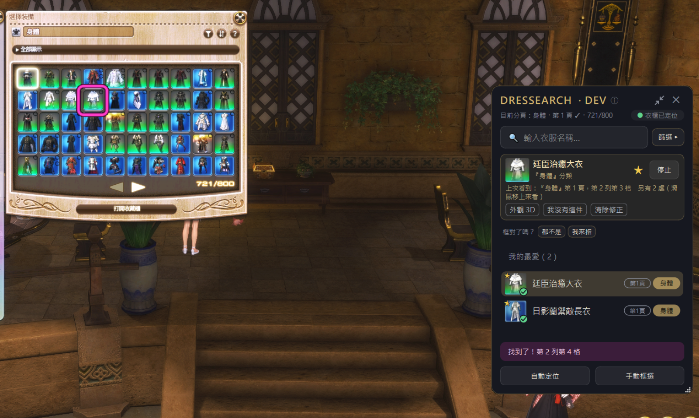
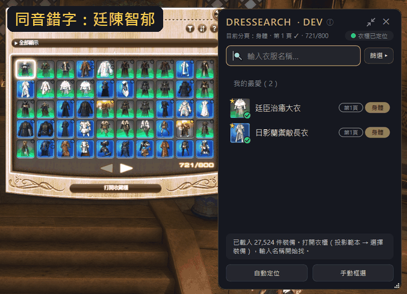
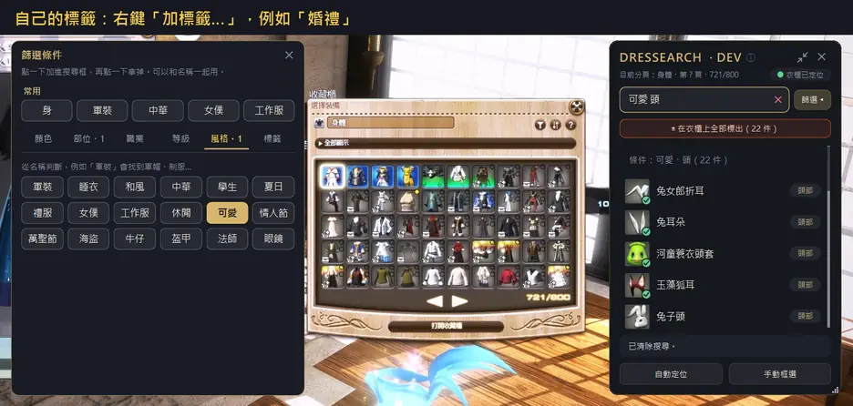
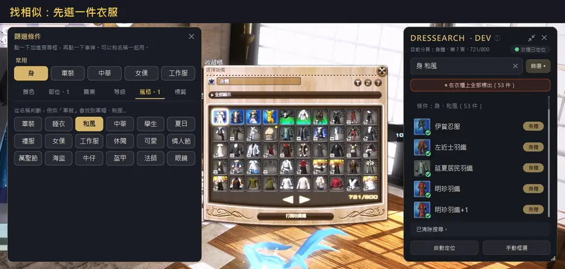
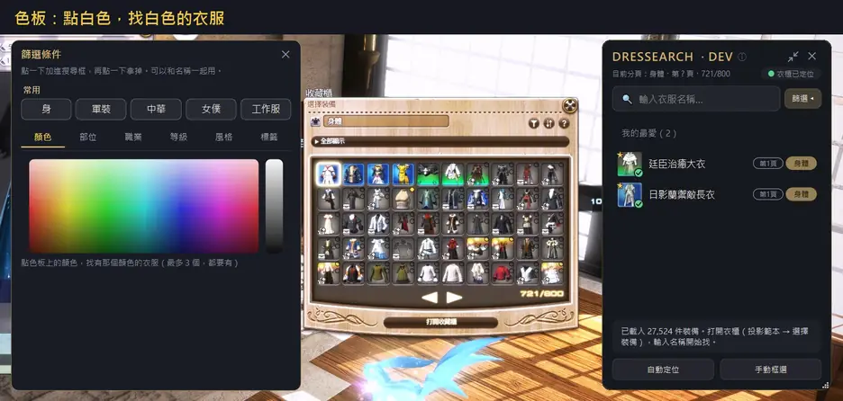
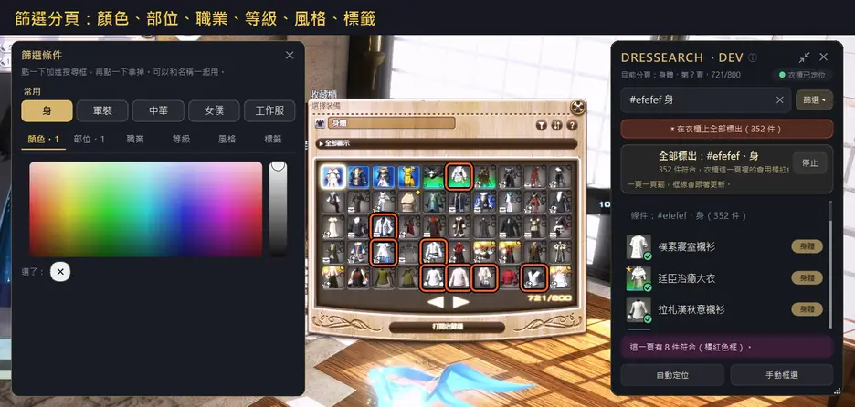
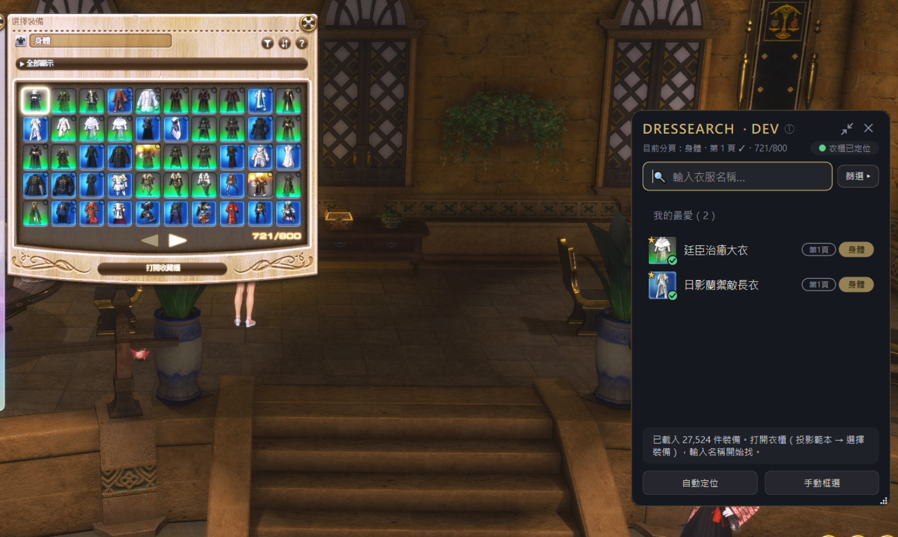

# Dressearch

Dresser + Search。FF14（繁中版）幻化衣櫃搜尋工具：輸入衣服名稱，在遊戲畫面上用懸浮框框出那件衣服在哪一格。

**下載**：到 [Releases](https://github.com/LaneBlossom/Dressearch/releases) 下載最新的 `Dressearch-版本.zip`，解壓縮後雙擊 `Dressearch.exe`（免安裝，不需要 Python）。

**打錯字也找得到**：同音錯字、忘了切輸入法打出的注音鍵、少打幾個字，都能找到對的衣服。

🎬 **新功能示範影片**（98 秒，色板、篩選分頁、找相似、風格、標籤）：[播放／下載](https://github.com/LaneBlossom/Dressearch/releases/download/v0.15.1/Dressearch-demo-0.15.mp4)

## 安全嗎？

- 只截取你自己螢幕上的遊戲畫面，用道具圖示比對出衣服在哪一格。
- 不讀寫遊戲記憶體、不修改遊戲檔案、不攔截網路封包，也**不會自動操作遊戲**（翻頁、點選都是你自己來）。
- 不附帶任何遊戲素材：道具名稱和圖示在第一次啟動時，從你自己安裝的遊戲讀取，只存在你的電腦裡。
- 只會連到 GitHub 檢查有沒有新版（可以關掉），除了程式版本號不會送出任何資料。
- 截取的畫面只在記憶體裡比對，**不會存成截圖、也不會上傳**。唯一的例外：你回報「框錯了」時，會把那一格衣服圖示縮成 16×16 的小圖資料，存在你的電腦裡，下次才不會再框錯。程式的資料（道具資料、衣櫃索引、設定、我的最愛）只存在 `%LOCALAPPDATA%\Dressearch`，刪掉這個資料夾和程式資料夾就完全移除。
- 程式沒有數位簽章（個人開發，憑證費用太高），所以 Windows 會跳出「Windows 已保護您的電腦」，這不代表有病毒；按「其他資訊 → 仍要執行」即可。從 0.17.1 開始，[Release](https://github.com/LaneBlossom/Dressearch/releases) 說明會附上 VirusTotal 掃描結果和檔案的 SHA-256，可以自己核對下載的檔案沒有被改過。只從這個 GitHub 頁面下載，別人轉載的檔案無法保證。
- 用 PyInstaller 打包的程式偶爾會被少數防毒軟體誤判，如果遇到可以回報給我。
- 坦白說：使用任何第三方工具，在遊戲條款上都不是官方允許的。本工具不碰遊戲本身，風險很低，但請自行評估。

## 使用方式

1. 解壓縮 `Dressearch-版本.zip`，雙擊資料夾裡的 `Dressearch.exe` 啟動（免安裝），會出現搜尋面板（固定在最上層，可以拖曳移動）。
   - 第一次啟動會從遊戲安裝資料夾讀取道具資料（約 15 秒）。遊戲沒裝在預設位置時，會請你選 FF14 的 `game` 資料夾（選到裡面的 `sqpack` 也可以）；之後要換可以在 ⓘ 裡「變更遊戲資料夾」。資料（道具資料、衣櫃索引、位置設定）存在 `%LOCALAPPDATA%\Dressearch\data`，所有版本共用。
   - 程式沒有數位簽章，Windows 可能跳出「Windows 已保護您的電腦」，按「其他資訊 → 仍要執行」。
   - 更新版本：有新版時，標題旁會顯示「有新版 0.x」，點一下可以看更新內容、前往下載。新版解壓縮到任何地方都可以（例如舊版旁邊），資料會自動沿用；舊版資料夾確定不用了可以直接刪掉。同時只能開一個 Dressearch。
     - 自動檢查更新可以在 ⓘ 裡關掉。只會連到 GitHub，除了程式版本號不會送出任何資料。
2. 遊戲裡打開「編輯投影範本 → 選擇裝備」，或是「投影台」。
   - 拖曳面板右下角可以調整大小，大小和位置都會記住。
3. 在搜尋框輸入名稱，點選清單中的道具。不用先切到正確的分類，所有分類一起找。
   - 打錯字也找得到：
     - **跳字**：少打幾個字也可以，例如「白貝帽」→ 白色貝雷帽。
     - **同音**：注音相同就算，不比聲調，例如「拜色背雷冒」→ 白色貝雷帽。
     - **近音**：ㄣ/ㄥ、ㄓ/ㄗ、ㄔ/ㄘ、ㄕ/ㄙ、ㄈ/ㄏ 視為相同，例如「金」→ 京。
     - **簡繁**：可以輸入簡體字。
     - **注音鍵**：忘了切換輸入法、打出一串英文字母也沒關係，例如 `uv;45k4;u4`（像這樣）。
     - **注音**：直接打注音符號也可以，例如 `ㄏㄨㄤˊㄐㄧㄚ`；不會寫的字也能用注音代替，例如 `白色ㄅㄟˋ雷帽`；也可以只打每個字的注音開頭，例如 `ㄅㄙㄅㄌㄇ`（白色貝雷帽）。
     - 用這些方式找到的道具，清單上會加上「跳字」「同音」「注音鍵」等小標籤；完全符合的道具一定排在前面。選取後會顯示正確名稱，也可以輸入到遊戲「選擇裝備」篩選的關鍵字欄位，讓它直接出現在第 1 頁。
   - 程式會從分類圖示（投影台則是有外框的分頁）判斷你目前在哪個分類（標題下方會顯示「目前分頁」），搜尋結果會把該分類排在最前面（金色標籤）。
   - **條件搜尋**：用空白隔開，可以加顏色（紅、黑…）、部位（頭、身、鞋…）、職業（騎士、PLD…）、等級（lv90、lv1-50）、染色（可染、雙染、不可染）、收藏櫃，例如「紅 身」「騎士 lv90 頭」「黑 鞋 長靴」。其他的字當名稱。顏色是從圖示估的，大約九成準。只輸入一個詞時還是照名稱找。
   - **風格搜尋**：輸入軍裝、睡衣、和風、中華、學生、夏日、禮服、女僕、休閒、可愛、盔甲、法師…等風格詞也找得到（從名稱判斷），可以和其他條件一起用，例如「和風 身」。
   - **自己的標籤**：在清單上按右鍵「加標籤…」，例如標成「婚禮」「套裝一」，之後輸入那個詞就會列出它們。

     

   - **找相似**：選了衣服後按資訊框的「找相似」，會列出同部位、長得像的衣服（同模型換色款、類似款式），你衣櫃裡有的排在前面。

     

   - **全部標出**：有條件時（例如「紅 身」），搜尋框下面會出現「在衣櫃上全部標出」，按下去會把衣櫃這一頁所有符合的格子都用橘紅色框標出來，翻頁跟著更新。
   - **篩選按鈕**：搜尋框右邊的「篩選」會在旁邊開一個小視窗，分成顏色、部位、職業、等級、風格、標籤幾個分頁，點了會加進搜尋框。最上面一排是你最常用的 5 個條件。
   - **色板**：「顏色」分頁是一塊色板，點哪個顏色就找有那個顏色（或相近顏色）的衣服，最多 3 個顏色。搜尋框會出現像 `#c86e9b` 的色碼。

     

   - 搜尋框右邊的 ✕ 會一次清掉搜尋文字和衣櫃上的框。

     
   - 選好衣服後會自動切回遊戲視窗，滑鼠移到框上就能看物品資訊。
   - **看外觀**：資訊框的「外觀 3D」按鈕（或清單右鍵）會用瀏覽器打開 Garland Tools 的物品頁，可以看外觀和 3D 模型（可旋轉、換種族）。太新的裝備那邊可能還沒有資料。
   - **辨識錯了可以修正**：資訊框下面的「框對了嗎？」可以按「是①」（第幾個框才對）、「都不是」或「我來指」（自己點正確的那一格）；資訊框裡的「我沒有這件」（或清單右鍵）可以標記衣櫃裡其實沒有，「清除修正」可以把這件的修正全部拿掉。修正會記在 `data/corrections.json`，下次就不會再錯。
   - **我的最愛**：選了衣服後按 ☆ 加入最愛（在清單上按右鍵也可以）。搜尋框是空的時候，清單會列出最愛，點一下就開始找；衣櫃索引記錄過的會顯示在第幾頁。

     
   - **衣櫃索引**：你翻過的每一頁，程式都會在背景記下來（存在 `data/dresser_index.json`）。之後搜尋到記錄過的衣服，會直接告訴你「上次看到：『身體』第 3 頁，第 2 列第 5 格」，清單上的圖示也會有綠色勾勾、排在前面。
     - 頁碼是程式自己推算的：看到格子下方的左箭頭變灰就是第 1 頁，往後翻一頁加一。剛開程式時如果不在第 1 頁，會顯示「第 ? 頁」，翻回第 1 頁（或切換一次分類）就好。
     - 標題下方：「讀取中…」表示正在讀這一頁，「第 3 頁 ✓」表示已經記下。翻頁後停一下下（約 0.3 秒）再翻下一頁最準。
     - 衣櫃有新增外觀或改了排序時，位置可能會跑掉，會註明「可能已移動」；再翻過一次就會更新。程式會讀格子右下角的數量（例如 `722/800`，讀到後會顯示在標題下方），數量變了就會自動把所有記錄標成「可能已移動」。
   - 程式開啟後（以及在搜尋框打字時）會自動找衣櫃，打開「選擇裝備」約 1～2 秒就會定位（藍色格子閃一下，找的時候狀態列下方有藍色進度條）；之後會記住位置。定位是靠「選擇裝備」視窗右上角的篩選、排序、? 三個按鈕，所以這三個按鈕不能被擋住。
   - 自動定位失敗時，按「**自動定位**」會再加上較慢的全畫面搜尋（約 20 秒）；還是不對的話，按「**手動框選**」，拖曳框住整個 10×5 格子區域（空格也框進去）。
   - 遊戲視窗縮小時會自動暫停，還原後繼續。
   - 面板右上角的狀態燈：綠色「衣櫃已定位」、橘色「衣櫃未開啟」、藍色「定位中」、灰色「已暫停／尚未定位」。
4. 切到該道具的分類，一頁一頁翻，框線會即時跟著更新：
   - **粉紅框**：找到了（滑鼠指著那件衣服、說明框蓋住它時，框會留在原地）
   - **橘框**：可能是，但不太確定
   - **虛線框**：外型很像的其他格子（例如換色款）
5. 按「停止」清除框線。
6. 不用的時候按右上角的縮小按鈕（向內收的雙箭頭）縮成小圖示（可以拖曳），縮小時不會截圖、不佔 CPU；要配衣服時點一下打開。

遊戲需要使用**視窗模式**或**無邊框視窗模式**，懸浮窗才蓋得上去。
遊戲更新後第一次開啟，會自動重新讀取道具資料。

## 遇到問題時

程式出錯或卡住時會記在 `error.log`。按面板標題旁的 ⓘ →「開啟資料位置」，把 `error.log` 傳給作者（不含使用者名稱等個人資訊）。

## 關於

- 作者：LaneBlossom（https://github.com/LaneBlossom）
- 更新內容：見 [CHANGELOG.md](CHANGELOG.md)。面板右上角的 ⓘ 可以查看版本。
- 授權：免費下載、個人使用；保留所有權利，詳見 [LICENSE](LICENSE)。內附的第三方元件依各自的授權條款提供（在程式資料夾的 `licenses` 裡）。
- 本工具為非官方粉絲作品，與 SQUARE ENIX 無關。FINAL FANTASY 為 SQUARE ENIX CO., LTD. 之註冊商標。README 的截圖只用來說明工具的用法，遊戲畫面的版權屬 SQUARE ENIX。
- 外部連結的網站（Garland Tools）與本工具無關，內容版權屬原網站及 Square Enix。本工具只用瀏覽器開啟該網站，不抓取它的資料。
- 問題回報：到 [Issues](https://github.com/LaneBlossom/Dressearch/issues) 留言。
